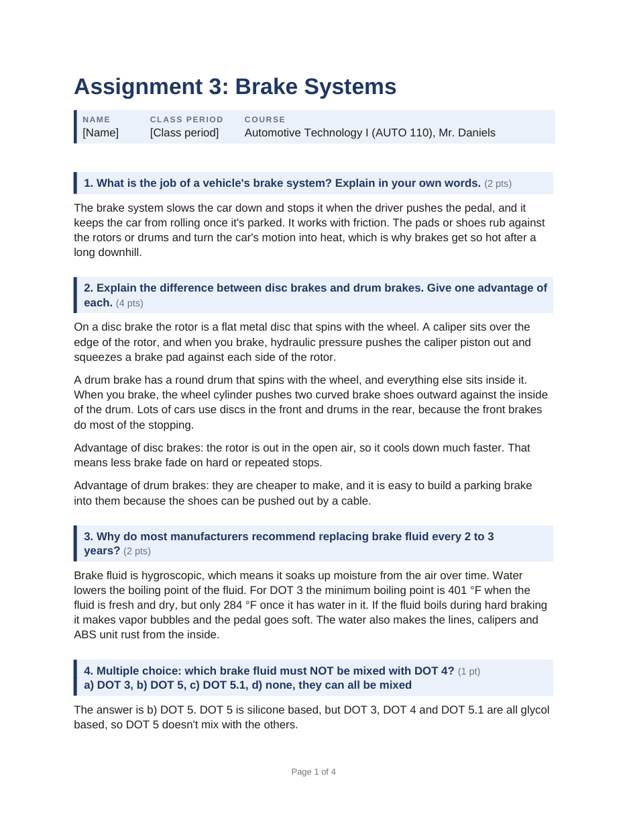
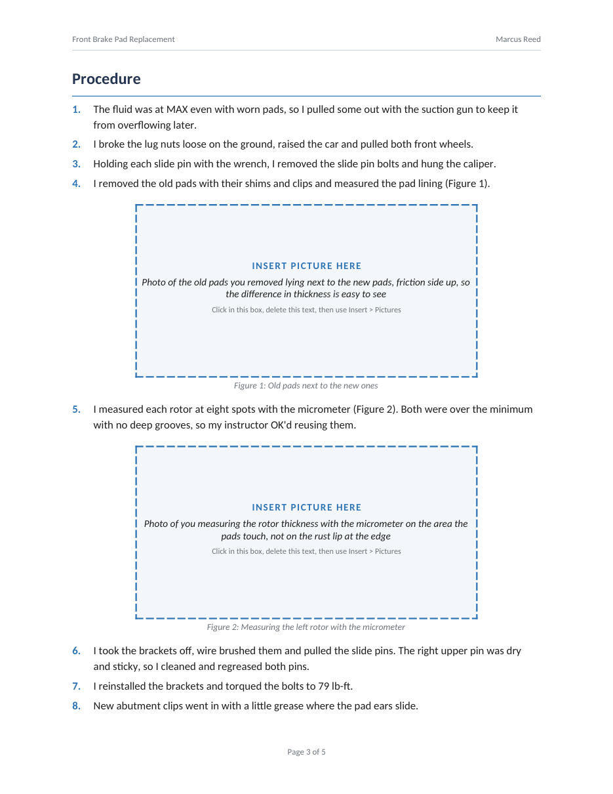

# Auto Mechanic Assignments: a Claude skill

Upload the PDF of an automotive school assignment and Claude does the whole thing: it reads every
page, answers every question or writes the full paper, and hands back a finished, professionally
styled Word document (.docx). The writing sounds like a student wrote it, and the document never
contains em dashes.

It handles worksheets and question sets, research papers, shop and lab reports, practical write-ups
and work placement reports on anything from brakes and cooling systems to EVs and diagnostics.

| Paper with cover page | Worksheet | Photos you add yourself |
|---|---|---|
|  |  |  |

## Install it in the Claude app (web, desktop or mobile)

1. **[Download auto-mechanic-assignments.zip](https://github.com/sanderv-pixel/auto-mechanic-assignments/releases/latest/download/auto-mechanic-assignments.zip)**
   (always the newest version). Don't unzip it.
2. In Claude, open **Settings > Capabilities** and turn on **Code execution and file creation**. The
   skill needs it to build the Word file.
3. Under **Skills**, click **Upload skill** and choose the zip you downloaded.
4. Make sure the skill is switched on.

Menu names can change a little between app versions. Look for "Skills" in Settings.

**Updating:** download the zip again from the same link, remove the old skill in Settings and upload
the new one.

## Install it in Claude Code

```bash
git clone https://github.com/sanderv-pixel/auto-mechanic-assignments.git
```

```bash
cp -r auto-mechanic-assignments/auto-mechanic-assignments ~/.claude/skills/
```

## How to use it

Start a new chat, attach the assignment PDF (a photo or scan works too) and write something like:

- "do this assignment"
- "here's my brakes homework, can you do it"
- "need this research paper done, my name is Jake Miller"

Claude sends back the Word file plus a short note telling you what to check:

- blanks to fill in, like your name or student number,
- measurements and vehicle details to swap for your own,
- pictures to add. Wherever the assignment needs a photo or drawing of your own, the document has a
  dashed "Insert picture here" box that says what to put there. Click in the box, delete the text and
  use Insert > Pictures.

## What the document looks like

- A cover page with the title and a details table for papers and reports, or a compact title block
  for worksheets.
- Questions in shaded boxes with the points shown, answers underneath.
- Tables with a dark header row, captions under figures, numbered steps.
- A running header with the title and your name, and "Page X of Y" at the bottom.
- A contents page with page numbers for longer papers.
- If the assignment sets a format (Arial 11, double spacing, APA references), Claude follows it.
  Strict formats get a plain black and white version.

See the [examples](examples) folder for four finished documents.

## Your details, filled in automatically

Unzip the download, fill in `assets/student-profile.md` (name, class, school, how you like to
write), zip the folder again and upload that zip. Or just put your name in the message when you send
an assignment.

## Tips

- Upload the course notes or textbook pages too if the assignment is based on them. Claude uses them
  as the main source.
- Always read the result before handing it in, so you can explain it if your teacher asks.

## For developers

```
auto-mechanic-assignments/   the skill (SKILL.md, scripts, references)
examples/                    finished example documents
tests/                       pytest suite for the scripts
test-files/                  sample assignment PDFs used by the tests
```

Run the tests (LibreOffice is optional; the render tests are skipped without it):

```bash
pip install python-docx pymupdf pillow pypdf pytest
```

```bash
pytest tests -q
```

To publish a new version, push a tag. GitHub Actions runs the tests, builds
`auto-mechanic-assignments.zip` and attaches it to the release, so the download link above serves it
right away:

```bash
git tag v1.1.0 && git push origin v1.1.0
```
